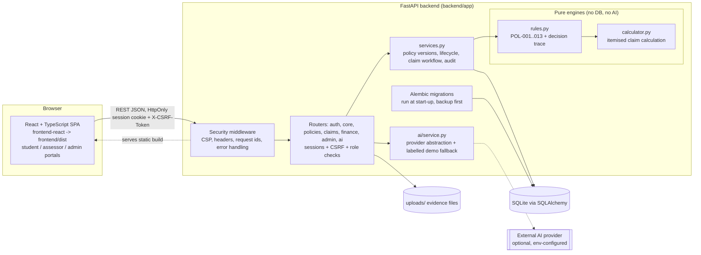

# Architecture

**Frontend (v2.1).** React 18 + TypeScript (strict) + Vite, built to `frontend/dist` and served by the same FastAPI process (same origin, so the HttpOnly cookie works and no CORS is needed). Node.js is a build-time tool only. `src/api.ts` is the single API client (cookie credentials, CSRF header on writes, central 401 handling); `src/auth.tsx` restores the session from `/api/auth/me` after a reload; `src/ui.tsx` holds the accessible form controls (label always associated), tabs, native-`<dialog>` modal, toasts and async helpers; `src/components/` holds the claim workspace shared by the three roles (overview, evidence, damage items, assessment and rules trace, reserves and payments, history); `src/pages/{student,assessor,admin,shared}` hold the portals. Role route guards are a usability layer; every endpoint is authorised on the server. There is no frontend-only data: every screen calls a real endpoint. One backend addition was made for the UI: student-declared damage items (`POST/DELETE /api/claims/{id}/student-items`).

**Separation of concerns**
* `engine/` is pure Python: input dictionaries in, decision trace + calculation out. It is the only place insurance decisions are made, so it is deterministic and unit-testable.
* `services.py` loads policy *versions* and claim data from the database, builds the engine context, stores each evaluation run (rule results + calculation lines) and enforces the claim/policy state machines.
* `ai/service.py` produces suggestions only. Results are stored in `ai_suggestions`; a human turns a suggestion into a `claim_items` row, which starts as `AI Suggested` and must be verified or corrected.
* Routers do authentication/authorization (`require_roles`) and HTTP validation only.
* Items declared by students enter as `Student Declared` (unpriced) and, like `AI Suggested` items, block completion of an assessment (POL-013) until an assessor verifies or corrects them.

**Claim flow**

```mermaid
stateDiagram-v2
  [*] --> Draft
  Draft --> Submitted: student (rules run)
  Submitted --> UnderAssessment: assessor
  UnderAssessment --> PendingInformation: assessor (reason)
  PendingInformation --> Submitted: student (rules run)
  PendingInformation --> UnderAssessment: assessor
  UnderAssessment --> AssessmentCompleted: assessor (re-evaluates; blocked if items pending)
  AssessmentCompleted --> ApprovedforReview: assessor (reason)
  AssessmentCompleted --> RejectedwithReason: assessor (reason)
  AssessmentCompleted --> UnderAssessment
  ApprovedforReview --> Closed
  RejectedwithReason --> Closed
```

"Approved for Review" is a recommendation state. Money only moves (in simulation) through the separate reserve and payment workflow: an assessor recommends a reserve, an administrator approves it, an assessor requests a payment, an administrator (never the requester) approves it, and settlement is simulated.
