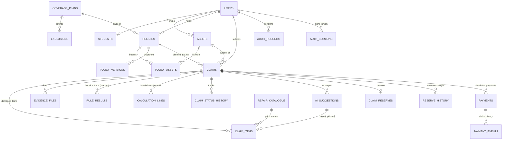

# Database ER diagram

Key columns
* `policy_versions.snapshot` (JSON): plan terms + insured asset IDs at that version; `effective_from` decides which version applies to an incident date.
* `claims.policy_version_used`, `claims.last_run`: which version/evaluation run the stored results belong to.
* `claim_items.verification_status`: `AI Suggested` or `Student Declared` -> `Human Corrected` / `Human Verified`; `ai_suggestion_id` links to the untouched AI output.
* `rule_results` / `calculation_lines` are append-only per `run`; history of earlier runs is retained.
* `audit_records`: who did what (JSON detail incl. before/after for item corrections).

## Added in v2.0 (migrations 0002, 0003)
`users` gained `is_active`, `password_changed_at`, `last_login_at`. New tables: `auth_sessions` (HMAC of session token, csrf token, expiry, revocation), `login_attempts`, `claim_reserves` (recommended/approved amount per claim), `reserve_history` (append-only), `payments` (simulated; unique `claim_id + idempotency_key`), `payment_events`, `system_settings`. `ai_suggestions` gained `meta` (provider/model/attempts/latency/usage/validation details) and `validation_status`.

`login_attempts` and `system_settings` are standalone tables (login rate limiting; maintenance banner and payments switch). No schema migration was needed in v2.1: `Student Declared` fits the existing `verification_status` column (`String(20)`).
